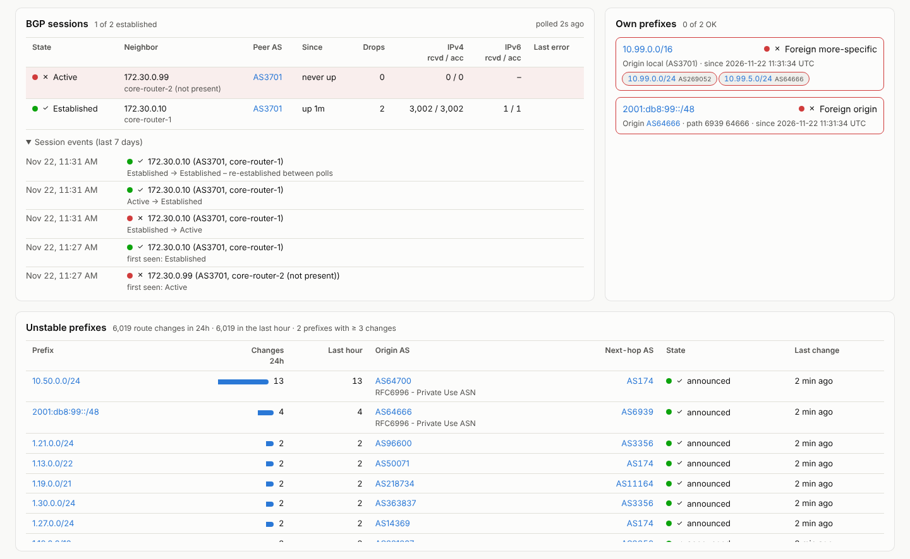

BGP Dashboard
=============

A "realtime" web view of your BGP network

- Who do I peer with?
- How many routes do I receive from my peers?
- Who do I use for transit?
- What AS path does a prefix take out of my network?
- How many routes and autonomous systems do I see, and how does that change over time?
- BGP Looking Glass (IPv4/IPv6/hostname/ASN) incl. route history
- Are all BGP sessions up? When did they flap and why?
- Are my own prefixes visible, with the right origin AS – or is someone announcing (parts of) them?
- Which prefixes are unstable (flapping, path changes)?
- Where (location) and how (transit / peering) do prefixes leave the network? Which peers'
  prefixes are still reached via transit?
- Prometheus metrics and ready-made alert rules


How it works
---------
```
 router ──BGP──▶ gobgp container ──────────────▶ mongodb ◀────── web container ──▶ browser
                 gobgpd + gobgp_to_mongo.py                       FastAPI (uvicorn)
```

###### gobgp (`./gobgp`)
- `gobgpd` (GoBGP v4, built from source, amd64 + arm64) peers with the real network.
  Configure it in [gobgp/gobgpd.conf](gobgp/gobgpd.conf). IPv4- and IPv6-unicast are supported.
- `gobgp monitor global rib --current -j` is piped into [gobgp_to_mongo.py](gobgp/gobgp_to_mongo.py),
  which writes the routes to MongoDB in batches (one `bulk_write` per batch, keeps up with a full table).
- Every prefix is one document. When the attributes of a prefix change, the previous version is
  kept in its `history` (newest first, `MAX_PREFIX_HISTORY` entries, default 100).
- Prefixes that have been inactive for `INACTIVE_PREFIX_DAYS` (default 30) are deleted by MongoDB
  (TTL index), so the database does not grow with every prefix ever seen.
- If `gobgpd` or the collector dies, the container exits and Docker restarts it. On start all
  stored prefixes are marked inactive and the RIB is learned again.
- Every 10s the collector also reads `gobgp neighbor -j` and stores the state of all BGP sessions
  plus every state change (session events, kept 90 days) and a heartbeat.

###### mongodb
- Stores the routes (`bgp`), cached ASN names (`asn_names`) and the counter history for the
  trend graphs (`stats_history`, kept for `stats_history_days`), the BGP session state (`neighbors`,
  `neighbor_events`) and the collector status (`collector_status`).

###### web (`./web`)
- One FastAPI process. A single background task computes all statistics with MongoDB
  aggregation pipelines (every `stats_interval` / `advanced_stats_interval` seconds); requests
  only read the cached result, so they are always fast – even while statistics are computed or
  MongoDB restarts.
- ASN names (Team Cymru DNS) and reverse DNS are cached (ASN names also in MongoDB).
- The dashboard is a single page without any CDN dependencies; it refreshes itself every 20s,
  keeps trend graphs across reloads, supports dark mode and has a built-in looking glass.
- Interactive API documentation: `http://<host>/docs`, health check: `http://<host>/healthz`,
  Prometheus metrics: `http://<host>/metrics`.


Screenshot
---------


Monitoring: BGP sessions with event log, own prefixes (here with a simulated hijack), unstable prefixes




Monitoring
---------
###### BGP sessions
The session table shows every neighbor configured in `gobgpd.conf` with state, up/down time,
received/accepted prefixes and the last disconnect reason. *Drops* counts how often an established
session was lost – also when it came back between two polls. All state changes are listed under
*Session events*. The status in the top right corner turns red when a session is down
(administratively disabled sessions are ignored).

###### Own prefixes
List your prefixes in `config/dashboard.toml`:
```toml
[monitoring]
own_prefixes = ["192.0.2.0/24", "2001:db8::/32"]
allowed_origins = [64500]   # optional: other ASNs allowed to originate them
```
Every minute each prefix is checked for
- **Missing** – not in the BGP table (or withdrawn),
- **Foreign origin** – originated by an AS other than your own (locally originated = empty AS path)
  or one of `allowed_origins` → possible hijack or misconfiguration,
- **Foreign more-specific** – a more specific prefix inside it is announced by a foreign origin AS
  → possible (sub-prefix) hijack.

The dashboard only sees what your router(s) send to GoBGP: this detects problems inside your view
of the Internet, not how others see your prefixes (use RIPE RIS / BGP monitoring services for that).

###### Unstable prefixes
The collector records the time of every real route change (attribute change, withdraw,
re-announce; not the re-learning after a restart). The dashboard lists the prefixes with the most
changes in the last `unstable_window_hours` (default 24h) plus the total churn.

###### Exits
If your routers tag routes on import with communities for the location and the kind of
neighbor, the dashboard shows per location how many prefixes leave via transit, peering or are
originated locally, which peers/exchanges deliver how many prefixes where, and which prefixes of
direct peers are still reached via transit (the peer does not announce them to you, or your
policy prefers transit). Configure it in `config/dashboard.toml`:
```toml
[network]
transit_community = "216333:100:100"
peer_community_prefix = "216333:101:"          # which peer / exchange
[exits]
location_community_prefix = "216333:105:"      # where the route was learned
peer_learned_community = "216333:100:120"
originated_community = "216333:100:130"
```
Only the best path per prefix is known: RouterOS sends only active paths, also with BGP
Add-Path, so backup paths are not visible.

###### RPKI
With an RPKI validator (Routinator, rpki-client) every active route is validated (RFC 6811) every
15 minutes: totals of valid / invalid / not-found routes, a list of all invalid routes with the
reason (origin AS not authorised, or more specific than the ROA allows) and the covering ROAs,
the RPKI state in the looking glass and an RPKI check of your own prefixes (ROA missing or not
matching). Configure the JSON export of the validator:
```toml
[rpki]
vrp_url = "http://routinator.example.net:8323/json"   # Routinator: http-listen must be enabled
```
The index of about 750,000 VRPs needs roughly 100 MB of memory, plus about 250 MB for a few
seconds while the export is loaded. Validating 1 million routes takes about 3 seconds.

###### Prometheus
Scrape `http://<host>/metrics` (example in [monitoring/prometheus-scrape.yml](monitoring/prometheus-scrape.yml))
and load the alert rules from [monitoring/bgp-alerts.yml](monitoring/bgp-alerts.yml):

| Alert | Fires when |
|-------|------------|
| `BGPSessionDown` | a session (not admin down) is not established for 2 min |
| `BGPSessionFlapping` | ≥ 3 session drops within an hour |
| `BGPSessionPrefixesDropped` | a session lost more than half of its accepted prefixes |
| `BGPOwnPrefixMissing` / `…WrongOrigin` / `…ForeignMoreSpecific` | see *Own prefixes* |
| `BGPOwnPrefixRPKINotValid`, `BGPRPKIDataStale` | own prefix without matching ROA, validator not reachable |
| `BGPTableSizeDrop` | the IPv4/IPv6 table shrank by more than 10 % within an hour |
| `BGPHighRouteChurn` | unusually many route changes |
| `BGPCollectorDown`, `BGPNeighborPollFailing`, `BGPDashboardStatsStale`, `BGPDashboardDown` | the dashboard itself has a problem |

Test the rules with `promtool test rules monitoring/bgp-alerts.test.yml`.
Main metrics: `bgp_rpki_routes`, `bgp_own_prefix_rpki_valid`, `bgp_exit_prefixes`, `bgp_transit_instead_of_peering_prefixes`, `bgp_session_up`, `bgp_session_drops_total`, `bgp_session_prefixes_accepted`,
`bgp_own_prefix_ok`, `bgp_prefixes`, `bgp_peer_prefixes`, `bgp_route_changes`,
`bgp_unstable_prefixes`, `bgp_collector_heartbeat_timestamp_seconds`.


Install
---------
```
$ git clone https://github.com/NetDevUG/bgp-dashboard.git
$ cd bgp-dashboard
$ # modify ./gobgp/gobgpd.conf to peer with your network
$ # modify ./config/dashboard.toml to use your ASN and BGP communities
$ docker compose build
$ docker compose up -d
$ docker compose logs -f gobgp            # verify the BGP session comes up
$ docker compose exec gobgp gobgp neighbor
```

Configuration changes never need a rebuild (`docker compose build` is only needed after code updates):

| File | Contents | Apply with |
|------|----------|------------|
| `gobgp/gobgpd.conf` | BGP sessions | automatically on save (GoBGP config auto-reload) |
| `config/dashboard.toml` | own ASN, customer/transit/peer communities, community names, refresh intervals | `docker compose restart web` |

Without customers leave `customer_community` empty: instead of the customer tiles the dashboard
then shows your own (originated) IPv4/IPv6 prefixes and the route changes of the last hour.

Environment variables (see `docker-compose.yml`):

| Variable | Default | |
|----------|---------|-|
| `WEB_PORT` | `80` | Port of the dashboard on the host |
| `MONGO_VERSION` | `8` | MongoDB image tag |
| `MONGO_CACHE_GB` | `1` | WiredTiger cache size |
| `MAX_PREFIX_HISTORY` | `100` | Versions kept per prefix (`0` = unlimited) |
| `INACTIVE_PREFIX_DAYS` | `30` | Prefixes withdrawn / not re-learned for this many days are deleted incl. history (`0` = never) |
| `NEIGHBOR_POLL_INTERVAL` | `10` | Seconds between BGP session polls (`0` = off) |
| `NEIGHBOR_EVENT_DAYS` | `90` | Days session events are kept |
| `GOBGP_CONFIG_AUTO_RELOAD` | `true` | Apply changes of `gobgpd.conf` without restart |
| `GOBGP_VERSION` (build arg) | `4.11.0` | GoBGP release built into the image |


Upgrading from the Flask version
---------
- `flask/app/constants.py` was replaced by `config/dashboard.toml` – copy your ASN, communities
  and community names over.
- `gobgp_to_mongo.py` and `bgp_attributes.py` moved to `./gobgp/`.
- The MongoDB data in `./db` is reused; documents get updated on the fly. On its first start the
  new collector adds two index fields to all stored prefixes (takes about a minute for a full table).
- MongoDB is now pinned to the major version `8` instead of `latest`. If your data was written by
  a newer major version, set `MONGO_VERSION` accordingly.
- All API URLs (`/bgp/api/v1.0/...`) and their JSON fields stay the same. New:
  `/bgp/api/v1.0/stats/history`, `community_names` in IP lookups, invalid lookups return HTTP 400.
- The web container listens on port 8000 inside the container (nginx, uWSGI and supervisor are gone).


API
---------
| Endpoint | |
|----------|-|
| `GET /bgp/api/v1.0/stats` | all dashboard statistics |
| `GET /bgp/api/v1.0/stats/history?hours=24&points=300` | counter history for trend graphs |
| `GET /bgp/api/v1.0/peers` / `customers` / `communities` | cached tables |
| `GET /bgp/api/v1.0/ip/<ip or hostname>` | longest prefix match |
| `GET /bgp/api/v1.0/ip/<ip>/history` | same, incl. previous versions of the route |
| `GET /bgp/api/v1.0/asn/<asn>` | prefixes originated by an ASN |
| `GET /bgp/api/v1.0/asn/<asn>/downstream` | ASNs directly behind a peer |
| `GET /bgp/api/v1.0/asn/<asn>/originated[/ipv4\|ipv6]` | originated prefixes |
| `GET /bgp/api/v1.0/asn/<asn>/nexthop[/ipv4\|ipv6]` | prefixes with that next-hop ASN |
| `GET /bgp/api/v1.0/asn/<asn>/transit` | prefixes with the ASN anywhere in the AS path |
| `GET /bgp/api/v1.0/domain/<domain>` | prefixes of the network hosting the domain's name server |
| `GET /bgp/api/v1.0/neighbors` | BGP sessions with state, uptime, drops, prefixes |
| `GET /bgp/api/v1.0/neighbors/events?hours=168` | session state changes |
| `GET /bgp/api/v1.0/own-prefixes` | result of the own prefix checks |
| `GET /bgp/api/v1.0/unstable` | prefixes with the most changes |
| `GET /bgp/api/v1.0/rpki` | RPKI validation summary and invalid routes |
| `GET /bgp/api/v1.0/exits` | exits by location and type, peers by location, transit although peered |
| `GET /metrics` | Prometheus metrics |


Prebuilt images and CI
---------
GitHub Actions ([.github/workflows/ci.yml](.github/workflows/ci.yml)) runs the tests (Python 3.15,
MongoDB 8) and the Prometheus rule tests on every push and pull request and builds both images for
`linux/amd64` and `linux/arm64`. Pushes to `master` and tags `v*` publish them to the GitHub
Container Registry:

```
$ docker compose -f docker-compose.yml -f docker-compose.images.yml pull
$ docker compose -f docker-compose.yml -f docker-compose.images.yml up -d
```
(or `COMPOSE_FILE=docker-compose.yml:docker-compose.images.yml` in `.env`; `BGP_DASHBOARD_TAG`
selects `latest`, a release such as `1.2.0` or `sha-<commit>`). Packages of an organisation start
as private: make them public in the package settings or run `docker login ghcr.io` first.

Dependabot opens weekly pull requests for new Python packages, base images and GitHub Actions; CI
shows right away whether they work. The GoBGP version (`GOBGP_VERSION` in `gobgp/Dockerfile`) is
not covered by Dependabot and has to be raised by hand.


Development
---------
```
$ docker run -d --rm -p 27017:27017 mongo:8          # tests use mongodb://localhost:27017
$ python3 -m venv .venv && . .venv/bin/activate
$ pip install -r web/requirements-dev.txt
$ pytest
$ cd web && MONGO_URI=mongodb://localhost:27017 uvicorn app.main:app --reload
$ MONGO_URI=mongodb://localhost:27017 python gobgp/gobgp_to_mongo.py < log/sample_data.log
```
