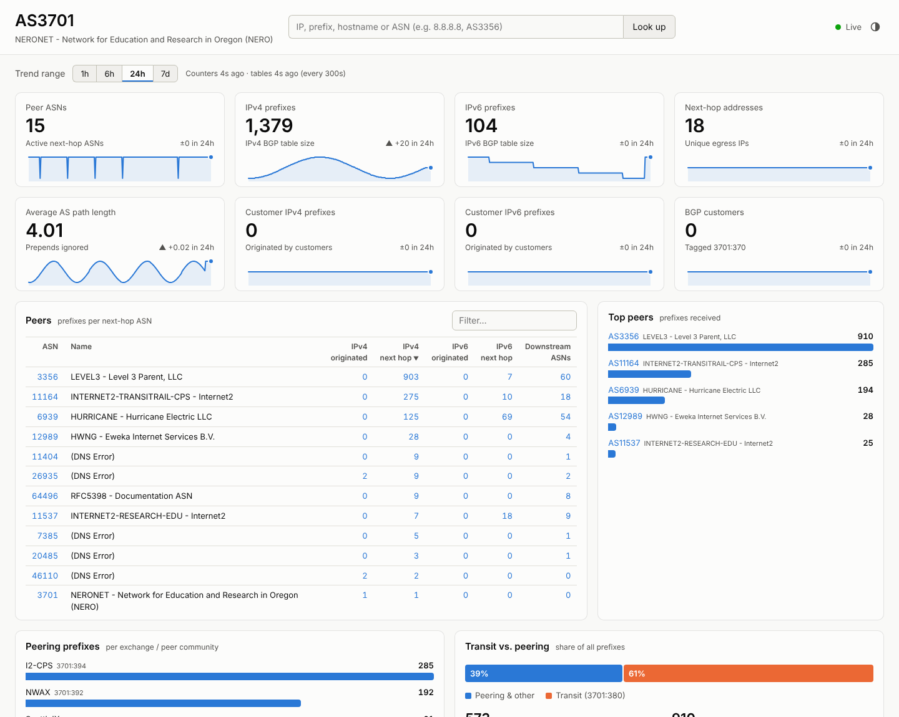

BGP Dashboard
=============

A "realtime" web view of your BGP network

- Who do I peer with?
- How many routes do I receive from my peers?
- Who do I use for transit?
- What AS path does a prefix take out of my network?
- How many routes and autonomous systems do I see, and how does that change over time?
- BGP Looking Glass (IPv4/IPv6/hostname/ASN) incl. route history


How it works
---------
```
 router ──BGP──▶ gobgp container ──────────────▶ mongodb ◀────── web container ──▶ browser
                 gobgpd + gobgp_to_mongo.py                       FastAPI (uvicorn)
```

###### gobgp (`./gobgp`)
- `gobgpd` (GoBGP v4, built from source, amd64 + arm64) peers with the real network.
  Configure it in [gobgp/gobgpd.conf](gobgp/gobgpd.conf). IPv4- and IPv6-unicast are supported.
- `gobgp monitor global rib --current -j` is piped into [gobgp_to_mongo.py](gobgp/gobgp_to_mongo.py),
  which writes the routes to MongoDB in batches (one `bulk_write` per batch, keeps up with a full table).
- Every prefix is one document. When the attributes of a prefix change, the previous version is
  kept in its `history` (newest first, `MAX_PREFIX_HISTORY` entries, default 100).
- If `gobgpd` or the collector dies, the container exits and Docker restarts it. On start all
  stored prefixes are marked inactive and the RIB is learned again.

###### mongodb
- Stores the routes (`bgp`), cached ASN names (`asn_names`) and the counter history for the
  trend graphs (`stats_history`, kept for `stats_history_days`).

###### web (`./web`)
- One FastAPI process. A single background task computes all statistics with MongoDB
  aggregation pipelines (every `stats_interval` / `advanced_stats_interval` seconds); requests
  only read the cached result, so they are always fast – even while statistics are computed or
  MongoDB restarts.
- ASN names (Team Cymru DNS) and reverse DNS are cached (ASN names also in MongoDB).
- The dashboard is a single page without any CDN dependencies; it refreshes itself every 20s,
  keeps trend graphs across reloads, supports dark mode and has a built-in looking glass.
- Interactive API documentation: `http://<host>/docs`, health check: `http://<host>/healthz`.


Screenshot
---------



Install
---------
```
$ git clone https://github.com/NetDevUG/bgp-dashboard.git
$ cd bgp-dashboard
$ # modify ./gobgp/gobgpd.conf to peer with your network
$ # modify ./config/dashboard.toml to use your ASN and BGP communities
$ docker compose build
$ docker compose up -d
$ docker compose logs -f gobgp            # verify the BGP session comes up
$ docker compose exec gobgp gobgp neighbor
```

Configuration changes do not need a rebuild:

| File | Contents | Apply with |
|------|----------|------------|
| `gobgp/gobgpd.conf` | BGP sessions | `docker compose restart gobgp` |
| `config/dashboard.toml` | own ASN, customer/transit/peer communities, community names, refresh intervals | `docker compose restart web` |

Environment variables (see `docker-compose.yml`):

| Variable | Default | |
|----------|---------|-|
| `WEB_PORT` | `80` | Port of the dashboard on the host |
| `MONGO_VERSION` | `8` | MongoDB image tag |
| `MONGO_CACHE_GB` | `1` | WiredTiger cache size |
| `MAX_PREFIX_HISTORY` | `100` | Versions kept per prefix (`0` = unlimited) |
| `GOBGP_VERSION` (build arg) | `4.11.0` | GoBGP release built into the image |


Upgrading from the Flask version
---------
- `flask/app/constants.py` was replaced by `config/dashboard.toml` – copy your ASN, communities
  and community names over.
- `gobgp_to_mongo.py` and `bgp_attributes.py` moved to `./gobgp/`.
- The MongoDB data in `./db` is reused; documents get updated on the fly.
- MongoDB is now pinned to the major version `8` instead of `latest`. If your data was written by
  a newer major version, set `MONGO_VERSION` accordingly.
- All API URLs (`/bgp/api/v1.0/...`) and their JSON fields stay the same. New:
  `/bgp/api/v1.0/stats/history`, `community_names` in IP lookups, invalid lookups return HTTP 400.
- The web container listens on port 8000 inside the container (nginx, uWSGI and supervisor are gone).


API
---------
| Endpoint | |
|----------|-|
| `GET /bgp/api/v1.0/stats` | all dashboard statistics |
| `GET /bgp/api/v1.0/stats/history?hours=24&points=300` | counter history for trend graphs |
| `GET /bgp/api/v1.0/peers` / `customers` / `communities` | cached tables |
| `GET /bgp/api/v1.0/ip/<ip or hostname>` | longest prefix match |
| `GET /bgp/api/v1.0/ip/<ip>/history` | same, incl. previous versions of the route |
| `GET /bgp/api/v1.0/asn/<asn>` | prefixes originated by an ASN |
| `GET /bgp/api/v1.0/asn/<asn>/downstream` | ASNs directly behind a peer |
| `GET /bgp/api/v1.0/asn/<asn>/originated[/ipv4\|ipv6]` | originated prefixes |
| `GET /bgp/api/v1.0/asn/<asn>/nexthop[/ipv4\|ipv6]` | prefixes with that next-hop ASN |
| `GET /bgp/api/v1.0/asn/<asn>/transit` | prefixes with the ASN anywhere in the AS path |
| `GET /bgp/api/v1.0/domain/<domain>` | prefixes of the network hosting the domain's name server |


Development
---------
```
$ docker run -d --rm -p 27017:27017 mongo:8          # tests use mongodb://localhost:27017
$ python3 -m venv .venv && . .venv/bin/activate
$ pip install -r web/requirements-dev.txt
$ pytest
$ cd web && MONGO_URI=mongodb://localhost:27017 uvicorn app.main:app --reload
$ MONGO_URI=mongodb://localhost:27017 python gobgp/gobgp_to_mongo.py < log/sample_data.log
```
